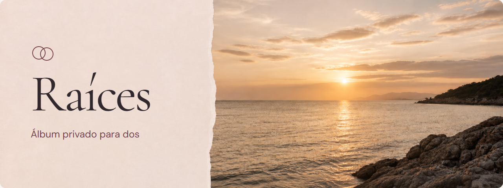
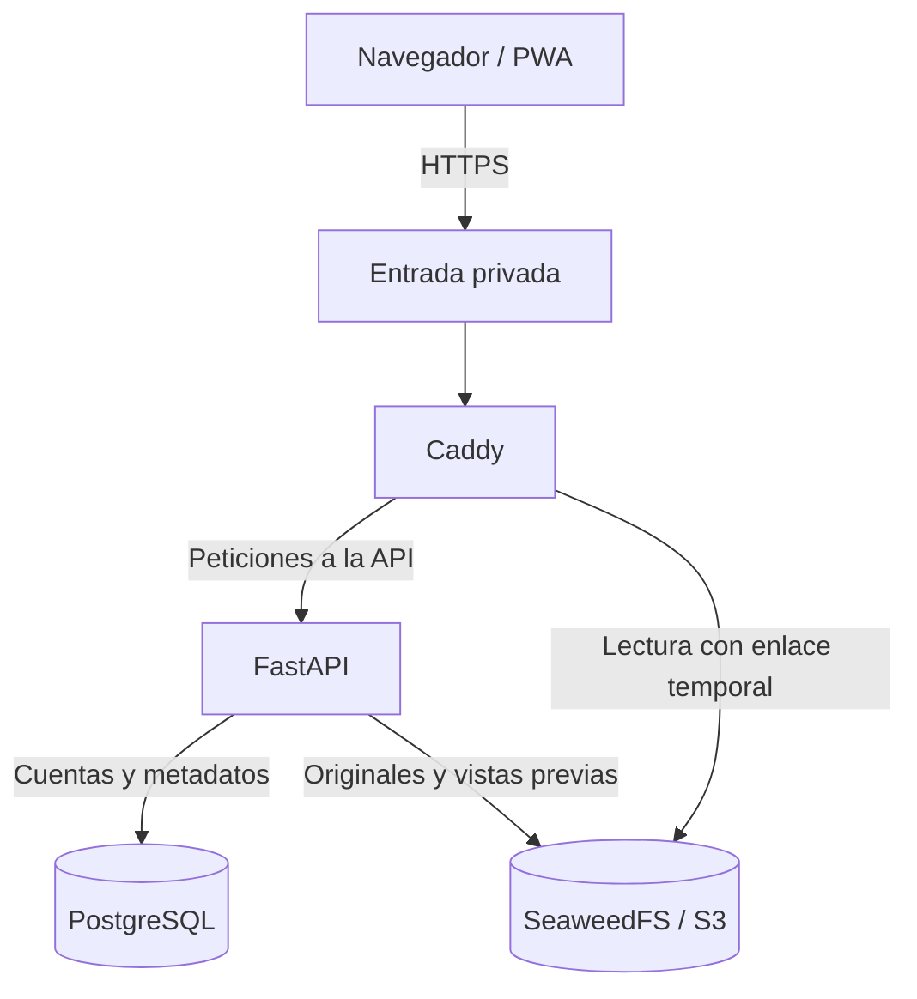

# Raíces · Our Memories

Creé **Raíces** para guardar con mi pareja las fotos y los vídeos que queremos volver a ver. Quería reunirlos en un álbum privado, con fechas y notas que nos ayudaran a recordar qué pasó y a encontrarlo después, sin tener que buscar entre conversaciones y galerías.

## Cómo la usamos

1. **Abrimos nuestro espacio.** Creo un espacio para dos y envío una invitación. Mi pareja la acepta desde su propia cuenta y los dos podemos acceder al álbum compartido.
2. **Guardamos el recuerdo con su contexto.** Desde **Añadir** puedo subir varias fotos o vídeos, revisar la selección y poner una fecha y una nota a cada archivo.
3. **Volvemos a lo que queremos recordar.** Puedo recorrer la cronología, reunir varios recuerdos en un álbum o marcar con un corazón los que quiero tener a mano. Cada cuenta tiene sus propios favoritos.

Por ejemplo, después de una escapada puedo subir una foto de la cala y mi pareja puede añadir un vídeo de las olas. Los reúno en **Domingo azul**, elijo la foto como portada y, más adelante, encuentro el vídeo desde el álbum en el móvil o filtrando la galería por fecha.

## La galería en escritorio

Organicé la galería por meses para que se pueda recorrer como una cronología. Puedo filtrar por tipo de archivo, fecha, álbum o favoritos. Al abrir una tarjeta, puedo ampliar la foto, reproducir el vídeo y pasar al recuerdo anterior o siguiente desde el visor.

## Un álbum en el móvil

Diseñé la vista de cada álbum alrededor de su portada. Debajo quedan la descripción, el número de recuerdos y las fotos y vídeos que reúne. En móvil puse la navegación en la parte inferior para que **Recuerdos**, **Añadir** y **Álbumes** queden al alcance del pulgar.

## Cómo lo construí

Elegí el papel marfil, el color vino y la tipografía editorial para acercar la interfaz a un álbum de fotos. Por dentro, separé la interfaz, las reglas del álbum y el almacenamiento de archivos. Así puedo recorrer la galería por páginas y cargar miniaturas sin descargar los originales.

### Stack

| Parte | Tecnologías | Qué construí |
| --- | --- | --- |
| Interfaz web | **React, TypeScript, Vite y TanStack Query** | Una interfaz adaptable a escritorio y móvil, preparada como PWA. Uso TanStack Query para gestionar las peticiones y cargar la cronología por páginas según los filtros activos. |
| API | **Python y FastAPI** | Implementé los flujos de sesión, invitación, subida y organización del álbum. Separé los casos de uso de las rutas HTTP y de los adaptadores de persistencia. |
| Datos | **PostgreSQL, SQLAlchemy y Alembic** | Guardo las cuentas, la pertenencia al espacio compartido, las fechas y notas de los recuerdos, los álbumes y los favoritos. Versiono el esquema con migraciones. |
| Archivos | **SeaweedFS, Pillow y FFmpeg** | Guardo los originales y sus variantes en un almacén privado compatible con S3. Genero miniaturas y vistas previas WebP con Pillow y extraigo un fotograma con FFmpeg para representar cada vídeo en la galería. |
| Infraestructura | **Caddy y Docker Compose** | Defino los servicios con Compose. Caddy sirve la interfaz y dirige las solicitudes a la API o al almacén de archivos según corresponda. |

### Arquitectura

**Cuando subo un recuerdo**, la API comprueba mi sesión y mi pertenencia al espacio compartido. Valida el archivo, genera sus variantes y guarda los metadatos en PostgreSQL. El original queda intacto en SeaweedFS, junto a las versiones ligeras que usa la galería.

**Cuando vuelvo a verlo**, la galería pide primero los metadatos por páginas. Para mostrar una miniatura o reproducir un vídeo, la API comprueba que tengo acceso al recuerdo y devuelve un enlace firmado que caduca. Caddy sirve el archivo a través de ese enlace, mientras el almacén sigue siendo privado.
