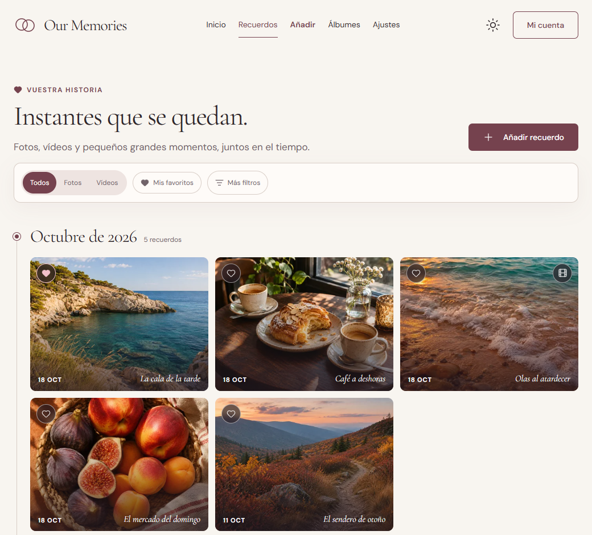
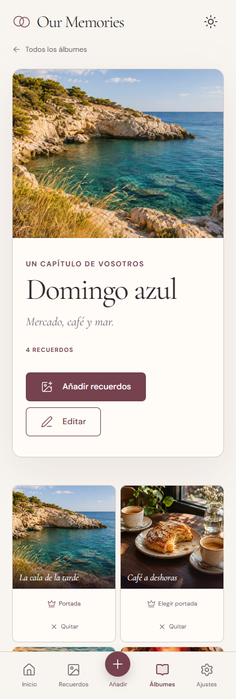

# Raíces · Our Memories

Creé **Raíces** para guardar con mi pareja las fotos y los vídeos que queremos volver a ver. Quería reunirlos en un álbum privado, con fechas y notas que nos ayudaran a recordar qué pasó y a encontrarlo después, sin tener que buscar entre conversaciones y galerías.

## Cómo la usamos

1. **Abrimos nuestro espacio.** Creo un espacio para dos y envío una invitación. Mi pareja la acepta desde su propia cuenta y los dos podemos acceder al álbum compartido.
2. **Guardamos el recuerdo con su contexto.** Desde **Añadir** puedo subir varias fotos o vídeos, revisar la selección y poner una fecha y una nota a cada archivo.
3. **Volvemos a lo que queremos recordar.** Puedo recorrer la cronología, reunir varios recuerdos en un álbum o marcar con un corazón los que quiero tener a mano. Cada cuenta tiene sus propios favoritos.

Por ejemplo, después de una escapada puedo subir una foto de la cala y mi pareja puede añadir un vídeo de las olas. Los reúno en **Domingo azul**, elijo la foto como portada y, más adelante, encuentro el vídeo desde el álbum en el móvil o filtrando la galería por fecha.

## La galería en escritorio

Organicé la galería por meses para que se pueda recorrer como una cronología. Puedo filtrar por tipo de archivo, fecha, álbum o favoritos. Al abrir una tarjeta, puedo ampliar la foto, reproducir el vídeo y pasar al recuerdo anterior o siguiente desde el visor.

## Un álbum en el móvil

Diseñé la vista de cada álbum alrededor de su portada. Debajo quedan la descripción, el número de recuerdos y las fotos y vídeos que reúne. En móvil puse la navegación en la parte inferior para que **Recuerdos**, **Añadir** y **Álbumes** queden al alcance del pulgar.

## Cómo lo construí

Elegí el papel marfil, el color vino y la tipografía editorial para acercar la interfaz a un álbum de fotos. Construí la interfaz adaptable con **React y TypeScript** y la API con **FastAPI**. Uso **PostgreSQL** para las cuentas y los datos del álbum, y un almacenamiento privado para las fotos y los vídeos. El acceso a los archivos se comprueba en el servidor según la cuenta y su pertenencia al espacio compartido.
